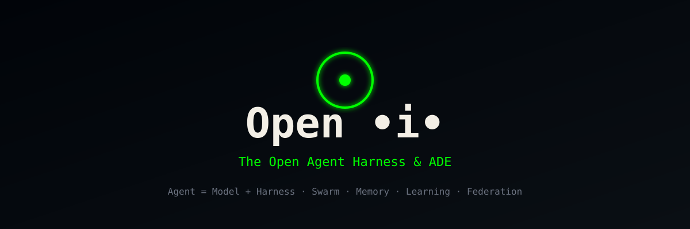

# Open •i• — The Open Agent Harness & ADE

<p align="center">
  
</p>

<p align="center">
  <strong>Agent = Model + Harness.</strong><br/>
  <strong>Open •i• is the open-source harness <em>and</em> the workspace.</strong>
</p>

Open •i• is the open Agent Harness and Agent Development Environment. It brings deep multi-agent orchestration, adaptive vector memory, self-learning intelligence, and zero-trust federation together with a polished desktop + mobile workspace that runs any CLI agent with your own subscription.

If you are searching for an **agent harness**, an **open agent harness**, a **multi-agent ADE**, or a self-hosted system that lets fleets of coding agents share memory, coordinate as swarms, and remain auditable — this is the project.

---

## What Is an Agent Harness?

An **agent harness** is the execution layer wrapped around a language model. The model writes. The harness gives it tools, memory, loops, sandboxes, permissions, and controls so it can actually do work.

The formula is simple and widely useful:

> **Agent = Model + Harness**

The model is the component you call. The harness is the part you own: the tool registry, the context manager, the memory store, the permission gate, the retry loop, the audit log, and the verification step. Improve the harness and reliability, cost, and capability all move. Keep the model fixed and change only the surrounding layer, and the same weights can produce markedly different results on real tasks.

Open •i• is a complete, open, ownable Agent Harness. It does not lock you to one model or one vendor. Any CLI agent can receive the full harness treatment — or run as a plain agent when you prefer. The distinction matters because most teams rent their models. They do not control the weights. What they can control is the loop, the tools, the memory, the permissions, and the evidence left behind. That controllable layer is the harness. Open •i• makes that layer explicit, modular, and yours.

Without a harness a model can only talk. With a harness it can act, remember, coordinate with other agents, recover from failure, and leave a trail that can be inspected later. The harness is also the place where policy lives. You decide which tools are available, which actions require confirmation, how much context is retained, how memory is written, and what counts as a successful outcome. These decisions are engineering decisions. They are not prompt decorations. They are the difference between a demo that looks impressive and a system that can be trusted with real work.

---

## Why Open •i• Exists

Most tools give you either deep coordination or a polished workspace, but not both in one open, ownable system. Open •i• is built to close that gap: one project that is both the intelligence layer and the human interface, under your control, with no lock-in.

The need is practical. Developers already run multiple coding agents. They run them in separate terminals, copy context by hand, lose useful intermediate results, and have no shared memory that survives the session. When the same task is tried by more than one agent, the results are hard to compare because the working trees collide or the diffs are scattered. When agents need to collaborate across machines, there is no standard, zero-trust way for them to discover each other, authenticate, and exchange work. When something goes wrong, the audit trail is incomplete. Open •i• addresses these gaps directly.

The project treats the harness as a first-class product surface rather than an internal implementation detail. That means the same concepts — worktrees, memory, swarm topology, federation, permissions — are visible to the human operator and available to the agents themselves. The operator can inspect memory, change topology, grant or revoke permissions, and export an evidence package. The agents can query memory, hand work to specialized roles, and participate in a federation mesh when the operator allows it. The result is a system that is both usable day-to-day and inspectable when questions arise.

---

## Core Architecture

Open •i• is organized into three planes. Each plane can be understood and evolved independently, yet they share a common control surface so the operator never has to context-switch between unrelated tools.

### 1. Experience Plane

The Experience Plane is the human-facing workspace. It provides parallel isolated Git worktrees so multiple agents can work on the same prompt without overwriting one another. It supports any CLI agent that can run in a terminal, so you are not locked to a single vendor’s interface. High-performance terminals with persistent scrollback and flexible splits keep long agent sessions readable. A mobile companion lets you monitor progress, receive notifications when an agent finishes or needs input, and send follow-up instructions without returning to the desktop. Design Mode captures UI elements — HTML, CSS, and screenshots — and inserts them into agent prompts so visual work stays grounded. Diff annotation lets you comment on changes and send those comments back to the agent. Integrations with common developer tools, SSH remote worktrees, computer use, and a quick search across worktrees, files, agents, and context round out the surface. The goal is that the operator can see what every agent is doing, compare results, and steer the fleet without losing the isolation that makes parallel work safe.

### 2. Harness Plane

The Harness Plane is the intelligence layer. It provides swarm coordination in hierarchical, mesh, and adaptive topologies, with consensus mechanisms so agents can agree on hand-offs and intermediate results. Adaptive vector memory, indexed for fast approximate nearest-neighbor search, supports hybrid retrieval, graph hops, and diversity ranking so relevant context can be recovered even as the store grows. Self-learning stores successful trajectories and reusable patterns so later runs can benefit without calling the model for every step. Zero-trust federation lets agents on different machines discover, authenticate, and exchange work under strong authentication, data redaction, and trust scoring. An MCP server exposes a broad tool surface for memory, swarm operations, routing, security checks, browser actions, and more; these tools can be injected into any compatible agent. A plugin system allows the surface to grow. Security scans and grading help operators assess readiness. Background workers handle recurring tasks. Cost tracking and compliance-oriented audit trails keep usage visible and claims checkable. The Harness Plane is what turns a collection of independent model sessions into a coordinated, remembering, auditable system.

### 3. Unified Control Plane

The Control Plane is the cockpit that unifies the other two. It shows worktree fleets and swarm topologies in one view. It supports an optional deep harness mode that injects memory, hooks, and coordination tools into any agent via MCP when the operator chooses. It includes a memory inspector, a learning trajectory viewer, and a federation mesh visualizer. Granular permission modes — read, ask, write, auto — let the operator decide how much autonomy each agent or swarm receives, and every important action is recorded in an audit log. The Control Plane also provides a terminal user interface, a visual console, and the full desktop experience so the same concepts are available whether you prefer a lightweight TUI or a richer graphical surface. The point is that the operator always has a single place to observe, intervene, and export evidence.

---

## Key Capabilities

- **Any agent, harnessed or plain** — Run any CLI agent. Inject the full harness when you want shared memory and coordination; leave it plain when you want a simple isolated session.
- **Parallel worktrees** — Fan one prompt across multiple agents, each in its own isolated Git worktree. Compare diffs, annotate, and merge the winner.
- **Shared vector memory** — An indexed store that persists across sessions, agents, and machines. Hybrid search, graph hops, and diversity ranking keep retrieval useful as the corpus grows.
- **Self-learning loop** — Agents improve from successful trajectories. Patterns are stored and reused so the system gets better without constant model calls.
- **Swarm coordination** — Hierarchical, mesh, and adaptive topologies. Consensus so agents can agree and hand off work.
- **Zero-trust federation** — Agents on different machines discover, authenticate, and exchange work with strong authentication, data redaction, and trust scoring.
- **MCP tool surface** — Tools for memory, swarm, routing, security, browser, and more, injectable into any agent that can speak the protocol.
- **Desktop + mobile** — Full ADE on desktop. Mobile companion for notifications and follow-up steering.
- **Evidence and audit** — Every important action is logged. The system can grade setups and produce evidence of what ran.

These capabilities are deliberately composable. You can start with parallel worktrees and no shared memory. You can add memory later. You can introduce a swarm only for the tasks that benefit from coordination. You can enable federation only between machines you control. The default is isolation and human oversight; additional capability is opt-in.

---

## How It Compares

| Capability              | Typical Framework | Single-Agent CLI | **Open •i•**                  |
|-------------------------|-------------------|------------------|-------------------------------|
| Agent Harness depth     | Partial           | Light            | Full (memory + learning + federation) |
| Any CLI agent           | Limited           | One              | Any                           |
| Parallel isolation      | Rare              | No               | Worktrees + swarm-aware       |
| Shared vector memory    | Add-on            | Session only     | First-class, cross-agent      |
| Self-learning           | Rare              | No               | Trajectory + pattern bank     |
| Federation              | No                | No               | Zero-trust mesh               |
| Desktop + mobile ADE    | No                | Terminal only    | Yes                           |
| Audit & evidence        | Light             | Light            | Built-in                      |
| Open source / ownable   | Varies            | Varies           | MIT, self-hostable            |

The comparison is not a claim of superiority on every axis for every user. It is a statement of scope. Open •i• aims to cover the harness and the workspace in one open project so that teams do not have to stitch together several tools and then invent their own memory, audit, and federation layers.

---

## Core Workflows

### Parallel Fleet

```bash
openi worktree fan "Implement the auth module" --agents agent-a,agent-b,agent-c
```

Each agent works in its own isolated worktree. You compare diffs, annotate, and merge the best result. This workflow is useful when you want multiple independent attempts at the same task and a clear way to choose among them. Isolation prevents one agent’s intermediate state from contaminating another. The operator remains in control of which changes land.

### Harnessed Swarm

```bash
openi swarm init --topology hierarchical --max-agents 12 --memory shared
openi swarm task "Design and implement the payment system with full test coverage"
```

A coordinating agent routes work to specialized roles. Shared memory and the learning loop stay active. This workflow is useful when a task benefits from division of labor — architecture, implementation, testing, security review — and when intermediate findings should be available to later roles without manual copying. Consensus mechanisms help the swarm agree on hand-offs and on what counts as done.

### Hybrid

Run plain agents and fully harnessed swarms side-by-side. Inject harness capabilities into any agent via MCP only when needed. This is the practical default for many teams. Most sessions stay simple. When a task grows, or when shared context becomes valuable, the harness can be attached without abandoning the agents you already use.

### Federated Edge

```bash
openi federation join --peer edge-node.local
```

Agents on your laptop, a remote machine, and a colleague’s machine collaborate with authentication, trust scoring, and data safety gates. Federation is zero-trust by design: identity is verified, data can be redacted or hashed before it leaves a boundary, and trust scores adjust based on observed behavior. This makes multi-machine and multi-organization work possible without assuming a single trusted network.

---

## Installation (Conceptual)

```bash
# One-line
curl -fsSL https://openi.dev/install.sh | bash

# Or
npm install -g @openi/cli
openi init
openi
```

Plugin path for compatible agents:

```
/plugin marketplace add openi/openi
/plugin install openi-core@openi
```

The installation path is deliberately simple. The CLI initializes a project, registers the local control surface, and prepares the memory and worktree directories. From there the operator can launch agents, create swarms, or join a federation peer. Exact package names and flags will stabilize as the implementation matures; the conceptual interface above is the intended shape.

---

## Brand & Aesthetic

Open •i• uses a near-black evidence-console aesthetic. Primary color is phosphor green `#00ff00`. The mark is an open ring with a central intelligence core — the “i” in Open •i•.

- Background: `#010409`
- Phosphor: `#00ff00`
- Secondary: clean white / warm paper for contrast
- Tagline: *Systems that prove what happened. Agents that remember and improve.*

The visual language is intentional. Near-black backgrounds and monospace typography signal a tool meant for operators who care about logs, diffs, and evidence. Phosphor green is high-contrast and immediately recognizable. The open ring with a central core is the project mark: an interface that is open, and an intelligence core that the operator controls. Favicon, Open Graph image, and Twitter card are included in the repository so shares and browser tabs look consistent. The same palette and mark appear in the desktop shell, the mobile companion, and the documentation so the project remains identifiable across surfaces.

---

## Guides & Documentation

Detailed guides live in `/docs`:

- [What Is an Agent Harness?](docs/guides/what-is-an-agent-harness.md)
- [Architecture Overview](docs/guides/architecture.md)
- [Experience Plane](docs/1-experience-plane.md)
- [Harness Plane](docs/2-harness-plane.md)
- [Control Plane](docs/3-control-plane.md)

These pages are written to be useful both for humans and for agents that need to understand the system. They define terms, list capabilities, and describe design principles so that later implementation work has a stable reference. Additional guides — getting started, memory and learning, federation and trust, security and audit — are planned as the implementation proceeds. The documentation is part of the product: an agent that can read the docs should be able to reason about its own capabilities and constraints.

---

## Roadmap

**Phase 1 — Foundation**  
Desktop ADE with parallel worktrees and any-agent support. MCP injection layer. Core vector memory. Basic swarm coordination. Mobile companion. This phase establishes the three planes and the ability to run agents in isolation or with light coordination.

**Phase 2 — Intelligence**  
Full self-learning loop. Zero-trust federation. Security grading and audit suite. Plugin marketplace. This phase makes memory and learning durable, enables multi-machine work under explicit trust policy, and gives operators tools to assess and extend the system.

**Phase 3 — Ultimate**  
Hybrid topology visualizer. Cross-organization federation with trust scoring. Edge / sovereign mode. Full compliance and audit export. This phase focuses on scale, multi-party trust, and the ability to produce evidence packages suitable for external review.

The roadmap is ordered so that each phase is usable on its own. You do not need federation to benefit from worktrees and memory. You do not need the full visualizer to benefit from basic swarm coordination. Later phases build on earlier ones without invalidating them.

---

## Design Principles

1. **Agent = Model + Harness.** The model is replaceable. The harness is the owned layer.
2. **Isolation by default.** Worktrees and sandboxes keep agents from interfering until you explicitly share.
3. **Memory is first-class.** Vector and graph memory persist and are queryable across sessions.
4. **Evidence over trust.** Actions are logged. Claims can be verified.
5. **Any agent.** Bring your own CLI agent and subscription. Inject the harness only where it helps.
6. **Ownable.** Self-hostable, MIT licensed, no mandatory cloud.

These principles are not slogans. They constrain implementation. Isolation by default means a new worktree is the ordinary path, not an advanced option. Evidence over trust means that a “done” claim is incomplete without a log entry that can be inspected. Ownable means the core system must run without a required external service, even if optional relays or marketplaces exist.

---

## Why This Matters

People searching for “agent harness”, “open agent harness”, “multi-agent ADE”, “agent orchestration open source”, or “vector memory for agents” should find a clear, ownable answer. Open •i• is written and structured so that:

- The definition of an agent harness is explicit and repeated.
- The difference between model and harness is clear.
- Concrete capabilities (memory, learning, federation, worktrees, any-agent) are listed and compared.
- Installation and workflow examples are copy-pasteable.
- Branding, metadata, and social cards are consistent so the project is recognizable when shared.

This is the engineering stance: measure, verify, admit, execute, prove. The harness is the part that makes those claims checkable. A system that cannot show what it did, what it cost, and whether the result passed is not yet a harness in the sense this project intends. Open •i• is built so that those questions have answers.

---

## Operational Notes

### Memory Lifecycle

Memory is written deliberately. An agent or the operator can store a note, a retrieved passage, a trajectory summary, or a pattern. Retrieval is ranked, not exhaustive. Hybrid search combines lexical and semantic signals; graph hops surface related entities; diversity ranking reduces redundant results. Memory can be scoped to a worktree, a swarm, a project, or a federation peer. Deletion and redaction are first-class so that sensitive material can be removed without dismantling the store. The memory inspector in the Control Plane shows what was written, when, by whom, and how it was later retrieved.

### Permissions and Autonomy

Permission modes are explicit. Read allows observation without mutation. Ask requires confirmation before side effects. Write permits changes under the current policy. Auto permits the agent or swarm to proceed within previously approved bounds. Modes can be set per agent, per swarm, or per federation channel. Changing a mode is itself an auditable event. The default is the most restrictive setting that still allows the intended work.

### Audit and Evidence

Every important action produces a log entry: tool calls, memory writes, permission changes, federation messages, and final claims of completion. An evidence package can be exported for later review. The package includes the relevant log slice, the memory keys that were read or written, the worktree diffs that resulted, and the permission state at the time. This is the practical meaning of “systems that prove what happened.” The harness does not merely enable action; it records it in a form that can be examined.

### Failure and Recovery

Agents fail. Tools time out. Context windows fill. The harness treats these as ordinary events. Retries are bounded and visible. Partial results are preserved in the worktree or in memory so that a later attempt can continue rather than restart from nothing. Swarm consensus can mark a role’s output as provisional until another role verifies it. Federation channels can drop and rejoin without losing local state. Recovery is a design requirement, not an afterthought.

### Extensibility

The plugin surface and the MCP tool surface are the two primary extension points. A plugin can add agents, skills, background workers, or UI panels. An MCP tool can expose a new capability to any compatible agent. Both are versioned and can be pinned. The project does not require that every capability ship in the core; it requires that extensions be discoverable, permissioned, and auditable. This keeps the core stable while allowing the system to grow with the needs of its operators.

---

## License

MIT. See [LICENSE](LICENSE).

---

## Built by

CodesbyFebin  
Systems that prove what happened.

**Open the interface. Own the intelligence.**
